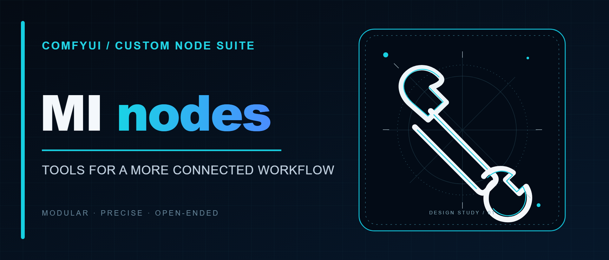
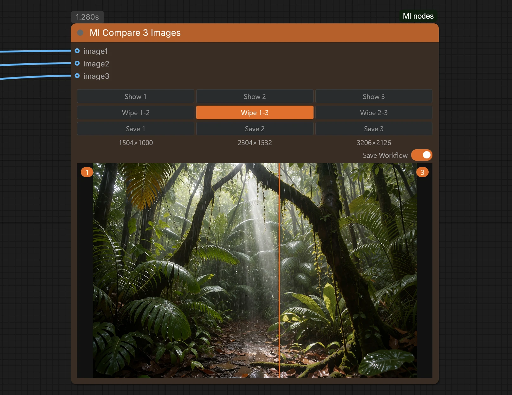
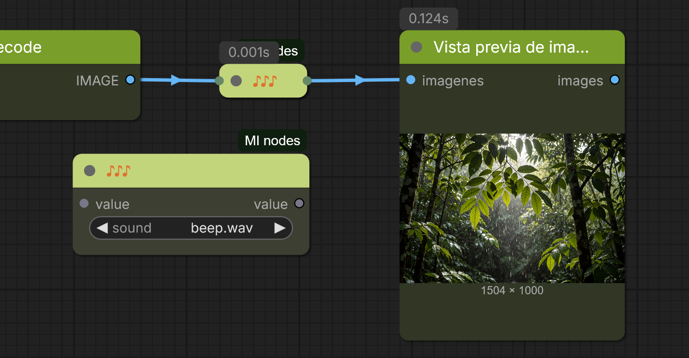
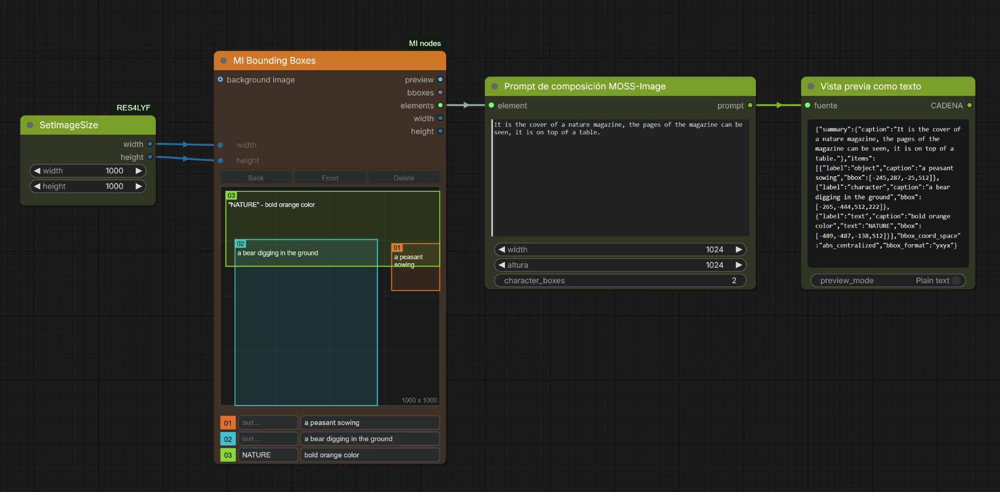

<p align="center">
  
</p>

# MI nodes

[](LICENSE)
[](https://github.com/comfyanonymous/ComfyUI)
[](https://registry.comfy.org/publishers/thinkingbells/nodes/mi-nodes)

**A pack of seven ComfyUI custom nodes** for everyday Stable Diffusion work: stack LoRAs with remembered (and Civitai-searchable) trigger words, pick embeddings from a dropdown, rate your diffusion models, compare three images side by side, save only the results you like, and get a sound when a long run reaches a point.

All nodes live under one menu category, **`MI nodes`**, and show the same **MI nodes** badge.

| Node | What it does |
|------|--------------|
| [MI Lora](#mi-lora) | Several LoRAs in one node: on/off per row, strength, remembered trigger words and a Civitai lookup |
| [MI Unet Rate](#mi-unet-rate) | UNET / diffusion-model loader where you rate (1-3 stars) and comment every model |
| [MI Embedding](#mi-embedding) | Embedding picker with strength, on/off switch and several rows |
| [MI Compare 3 Images](#mi-compare-3-images) | Compare up to three images inside the node: switch, wipe, save |
| [MI Save Image](#mi-save-image) | Preview in `temp`, copy to `output` only when you press **SAVE** |
| [MI Reroute Sound](#mi-reroute-sound) | A minimal reroute that plays a WAV sound when the flow passes through it |
| [MI Bounding Boxes](#mi-bounding-boxes) | Draw labelled boxes on a canvas inside the node (classic LiteGraph) for MOSS-Image and Ideogram |

## Installation

**With git** (recommended, always the latest version). Clone into your ComfyUI `custom_nodes` folder:

```bash
cd ComfyUI/custom_nodes
git clone https://github.com/ThinkingBells/MI_nodes.git
```

**With ComfyUI-Manager or comfy-cli.** Search for **MI nodes** in the Manager, or run `comfy node install mi-nodes`. The registry publishes each version after a review, so it can be a little behind this repository.

Then restart ComfyUI and reload the browser tab (Ctrl+F5). No extra Python dependencies are needed.

> Keep the folder name `MI_nodes`. It must not contain spaces: ComfyUI cannot serve the interface files of a folder with a space in its name.
>
> If you previously installed the standalone packages (`MI_lora`, `MI_embedding`, `MI_unet_rate`, `MiCompare_3_images`, `MIsave_image`), remove them first or the nodes will appear twice. The internal node names are unchanged, so existing workflows keep working.

To **update**: `git pull` inside the folder and restart. To find a node: double-click the canvas and type its name, or browse the **MI nodes** category.

**Compatibility:** developed and tested with ComfyUI 0.42 and frontend 1.55 (classic canvas), Python 3.10+.

---

## MI Lora

Loads several LoRAs from one node and **remembers the trigger words of each one**. Write the trigger words once: they are saved per LoRA, filled in automatically the next time you pick it, and sent as text to your prompt. Not sure what a LoRA's trigger words are? Look them up on Civitai from the node.


**Why:** stacking LoRAs usually means a chain of loader nodes plus a notes file to remember which words activate each one. MI Lora puts the LoRAs, their strengths, their trigger words and an on/off switch in one compact node.

**Features**

- **Several LoRAs in one node**: `+` / `-` buttons add or remove rows (up to 8).
- **On / off per LoRA**: a row that is off is skipped (the LoRA is not applied and its trigger words are not sent). Its fields are greyed out and the saved words are kept.
- **One strength per LoRA**: from -10 to 10, applied to both model and clip.
- **Trigger words per LoRA**: saved for that LoRA and filled in whenever you pick it again, in any node or workflow.
- **Civitai lookup**: press **search triggers on Civitai** at the bottom of the node. Every active LoRA is looked up by its file hash and a framed box lists the trigger words found, one numbered result per row. Click a result to put its words in that row's `triggers` field. Long lists wrap onto several lines. Results without trigger words (or not found) are shown in italics and are not clickable.
- **Sent as text**: the `text` output is your incoming prompt followed by the trigger words of every active LoRA.
- **Subgraph friendly**: every row uses standard widgets.

**Usage**

1. Connect `model` and `clip`, and optionally a `STRING` prompt to `text`.
2. Pick a LoRA, set its strength and write its trigger words (comma separated), or fetch them from Civitai.
3. Connect `model` and `clip` to your sampler and text encoder, and `text` to the text input of a `CLIPTextEncode` (convert the widget to an input first).

| Text in | LoRA rows | `text` output |
|---------|-----------|---------------|
| `1girl,` | `add_detail` (on), `Cute Faces` (on) | `1girl, detail, cute faces` |
| `1girl,` | `add_detail` (on), `Cute Faces` (off) | `1girl, detail` |
| nothing connected | `add_detail` (on) | `detail` |

Rows set to `(none)` are ignored.

**Civitai lookup and privacy.** Nothing is sent until you press the search line. Then only the SHA256 hash of each active LoRA file is sent to `civitai.com`, never the file itself. Hashes are cached in `data/hashes.json`, so each file is hashed only once (the first search on a large LoRA can take a few seconds). A LoRA that is not on Civitai, or that lists no trigger words, is reported as such.

**Good to know:** trigger words are tied to the LoRA path and file name inside the `loras` folder; renaming a file makes it a new LoRA. The LoRA list is read at startup, so restart ComfyUI after adding files.

---

## MI Unet Rate

A UNET / diffusion-model loader that lets you **rate** and **comment** every model right where you pick it. File names alone are rarely enough to remember which of your dozens of checkpoints are worth using; this keeps your own judgement next to each model.


**Features**

- **Rate each model from 1 to 3 stars** with one click on the row under the selector.
- **Comment each model**: best sampler and scheduler, steps and CFG, resolution, known problems... (single line, up to 300 characters).
- **Everything visible at a glance**: stars are shown in front of the model name in the dropdown and in the selected value, so you can scan the list and spot your favourites.
- **Drop-in replacement for the standard UNET loader**: outputs `MODEL` and has the same `unet_name` and `weight_dtype` inputs.
- **Your data stays local**: plain JSON files, nothing is sent anywhere.

**Usage**

1. Pick a model in `unet_name`.
2. Click star 1, 2 or 3 to set the rating (clicking the last active star lowers it, down to none).
3. Click the comment field on the left, type your note and confirm.

Ratings and comments belong to the model, so they are shared by every MI Unet Rate node and every workflow.

---

## MI Embedding

Pick textual-inversion embeddings from a dropdown, set the strength of each one and switch everything on or off, without typing `embedding:name` by hand.


**Features**

- **Dropdown of your embeddings**: every file ComfyUI sees in the `embeddings` folder (including folders from `extra_model_paths.yaml`).
- **Strength per embedding**: from -10 to 10, default 1.0.
- **Enable / disable toggle**: when disabled, the incoming text passes through untouched, so you can compare with and without embeddings without rewiring.
- **Several embeddings in one node**: `+` / `-` buttons (up to 8 rows).
- **Before / after text**: choose where the embeddings go relative to the incoming prompt.
- **Subgraph friendly**.

**Usage:** optionally connect a `STRING` prompt to `text`, pick an embedding and set its strength, then connect the `text` output to a `CLIPTextEncode`.

| Rows | Text in | Position | Output |
|------|---------|----------|--------|
| `epiCPhoto.pt`, 1.0 | `1girl` | before text | `embedding:epiCPhoto, 1girl` |
| `epiCPhoto.pt`, 1.3 | `1girl` | after text | `1girl, (embedding:epiCPhoto:1.3)` |
| `epiCPhoto.pt`, 0.8 | none | before text | `(embedding:epiCPhoto:0.8)` |
| `epiCPhoto.pt`, 1.3 | `1girl` | disabled | `1girl` |

**Good to know:** embeddings must match your model family (SD1.5, SDXL...). The list is read at startup.

---

## MI Compare 3 Images

Compare **up to three images** inside the node itself.



**Features**

- Three optional `IMAGE` inputs: `image1`, `image2`, `image3` (a muted or unconnected branch never raises an error).
- **Show 1 / Show 2 / Show 3** buttons switch the displayed image.
- **Wipe 1-2 / Wipe 1-3 / Wipe 2-3** buttons compare a pair: hover the viewer and a bar follows the cursor, revealing one image or the other.
- **Save 1 / Save 2 / Save 3** buttons save the matching image to the `output` folder as `MM-dd-HH-mm-ss-imageN.png`.
- The resolution of each image is shown under its Save button.
- The viewer fills the node and scales when you resize it.
- Images and the selected view are remembered when you switch workflow tabs or reload.
- **Save Workflow** switch (orange = on): embeds the workflow in the saved PNG so it can be dragged back into ComfyUI (skipped if ComfyUI runs with `--disable-metadata`).

**Usage:** connect up to three images, run the workflow, pick with **Show N**, compare with **Wipe A-B**, save with **Save N**. Previews live in ComfyUI's `temp` folder, so they disappear after a restart until the workflow runs again.

*Inspired by the Image Compare Pixaroma node from [ComfyUI-Pixaroma](https://github.com/pixaroma/ComfyUI-Pixaroma) (MIT). This is an independent, simplified reimplementation.*

---

## MI Save Image

Receives one or several images and saves them to ComfyUI's `temp` folder with a preview. Nothing reaches your `output` folder until you decide: the **SAVE** button copies the visible image (or all images in grid view) there. It also passes the images through, so you can keep chaining nodes.


**Features**

- **Preview first, save later**: no more `output` folder full of discarded results.
- **SAVE button** on the node.
- **Date-based file names**: `filename_prefix` defaults to `%date:MM-dd-hh-mm-ss%` (tokens `yyyy`, `yy`, `MM`, `dd`, `hh`, `mm`, `ss`). A subfolder can be included, e.g. `portraits/%date:yyyy-MM-dd%`.
- **Never overwrites**: if a name exists, `_1`, `_2`... is appended.
- **Workflow embedded** in the PNG, so saved images can be dragged back into ComfyUI.

---

## MI Reroute Sound

A minimal reroute: whatever you connect passes through unchanged, and when the flow goes through it the chosen **WAV sound plays**. Handy to know that a long generation has reached a point, without watching the screen.



**Features**

- **Accepts any type** (image, latent, model, text...) and returns it untouched, like a normal reroute.
- **Tiny by design**: it starts collapsed, just three orange notes (♪♪♪) with the input and output dots.
- **Sound picker**: expand the node (click the dot at the left of the title) to choose a `.wav` from the `sounds/` folder. Picking one plays it as a preview. `(none)` keeps it silent.
- Includes six small sounds (`ding`, `chime`, `beep`, `done`, `soft`, `low`). Drop your own `.wav` files into `sounds/` and restart ComfyUI to see them in the list.

**Usage:** put it on any link (for example after the sampler or after MI Save Image), choose a sound and run the workflow. The sound plays in your browser when the node is executed. If a node is cached and does not run again, it does not play.

---

## MI Bounding Boxes

A box editor drawn directly on the node's canvas, so it works in the **classic LiteGraph** frontend (no Vue widget). It produces the same data as the core *Create Bounding Boxes* node, so you can wire it to **MOSS-Image Layout Prompt**, **Build JSON Prompt (Ideogram)** or the Flux layout prompt.



**Usage**

- Drag on an empty part of the canvas to draw a box; drag a box to move it; drag a corner handle of the selected box to resize it.
- Each box gets a row under the canvas with its number (in the box colour), a short **text** field (text to render; leave it empty for a plain object) and a **description** field. Click a field and type; long text wraps and the node grows.
- Buttons: **Back / Front** (change the order: first box = background, last = foreground) and **Delete**.
- Boxes are numbered `01, 02...` in the canvas and in the preview; MOSS uses these numbers in its `character_boxes` field.
- Optional **background image** input: used as the canvas background and its size replaces `width` / `height` (shown after the first run).

**Outputs:** `preview` (IMAGE), `bboxes` (BOUNDING_BOX, pixels), `elements` (ARRAY, `bbox` = `[ymin, xmin, ymax, xmax]` on a 0-1000 grid), `width`, `height`.

---

## Where the data is stored

Personal data is kept in the `data/` folder of this package and is ignored by git:

| File | Content |
|------|---------|
| `triggers.json` | LoRA name to trigger words (MI Lora) |
| `hashes.json` | Cached SHA256 of your LoRA files, for the Civitai lookup (MI Lora) |
| `ratings.json` | Model name to rating, 1-3 (MI Unet Rate) |
| `notes.json` | Model name to comment (MI Unet Rate) |

Back them up if you want to keep them. Nothing leaves your computer except the LoRA hash you send to Civitai when you press the search line.

## Repository layout

```
MI_nodes/
├── __init__.py        # registers all nodes
├── nodes/             # one Python module per node
├── js/                # frontend extensions
├── sounds/            # .wav files for MI Reroute Sound
├── images/            # banner and screenshots
└── data/              # your ratings, notes, trigger words and hashes (not in git)
```

## License

[MIT](LICENSE) © 2026 Thinkingbells
